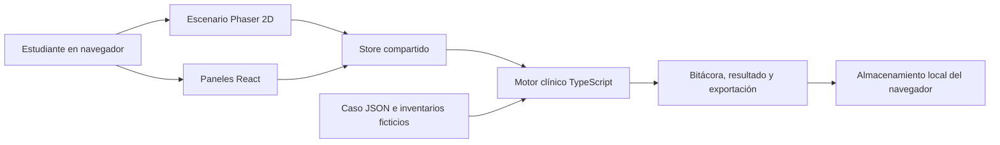

# SIMUL-ANDE · Guardia virtual 0.2

**Entrega actualizada · 11 de noviembre de 2026.** El prototipo vigente es un simulador clínico **visual 2D** en React, TypeScript y Phaser 3, no el cuestionario Streamlit anterior.

**[Abrir simulador visual](https://simul-ande-visual-vroman.sugary-bass-7867.chatgpt.site/)** · **[Código del juego](visual/)** · [Validación técnica](docs/visual/VALIDATION.md) · [Comentario del diplomado](https://github.com/d2cml-ai/Data-Science-Python/issues/204#issuecomment-6785760104)

> Caso ficticio de neumonía adquirida en la comunidad; contenido clínico **pendiente de revisión médica VM-01–VM-05**. Exclusivamente educativo; no usar para atender pacientes reales ni certificar competencias.

## 1. One-liner

SIMUL-ANDE permite a estudiantes de medicina, internos y futuros médicos SERUMS practicar decisiones clínicas dentro de un escenario interactivo, considerando los recursos y restricciones declarados de establecimientos ficticios del primer nivel peruano.

## 2. Founder

Victor Roman, participante del diplomado Q-Lab PUCP, impulsa el diseño clínico y educativo. La validación médica formal y la investigación con usuarios aún están pendientes y no se presentan como completadas.

## 3. Problema y evidencia con usuarios

**Hipótesis por validar:** la formación basada en escenarios con disponibilidad amplia de recursos prepara de forma incompleta para priorizar atención, soporte y referencia en contextos peruanos con restricciones operativas. Alternativas actuales incluyen discusión con docentes, guías, bancos de preguntas y simuladores internacionales. No se ha cuantificado la frecuencia, impacto ni disposición a pagar.

Las **tres conversaciones con usuarios potenciales** exigidas en la [tarea #204](https://github.com/d2cml-ai/Data-Science-Python/issues/204) continúan pendientes. Se mantienen [guía y plantillas vacías](docs/research/README.md), sin testimonios inventados.

## 4. Solución e insight

Un paciente ficticio y una sala 2D permanecen visibles. El estudiante puede entrevistar, medir SpO₂, explorar, instalar soporte, consultar el botiquín, solicitar pruebas disponibles y coordinar una referencia, en un orden flexible. Sus acciones modifican el tiempo docente, el inventario y la bitácora. El debriefing muestra puntuaciones formativas por dominios y alertas críticas.

El caso distingue un puesto **I-2 ficticio** de un centro **I-4 ficticio**. Los recursos están definidos explícitamente en el inventario: **la categoría del establecimiento no demuestra por sí sola stock ni capacidad operativa**. Los signos posteriores a las intervenciones no se inventan y las animaciones son ambientales, no fisiológicas. Véanse [reglas y límites](docs/visual/RULES.md).

## 5. Why now

Los motores 2D web, los casos estructurados en JSON y las pruebas automatizadas permiten distribuir un escenario interactivo por HTTPS sin instalar software, manteniendo un motor de reglas auditable. La eficacia educativa, la usabilidad y la demanda comercial aún deben validarse.

## 6. Demo, tecnología y evidencia

- **Demo principal 2D:** https://simul-ande-visual-vroman.sugary-bass-7867.chatgpt.site/
- **Código visual:** [visual/](visual/) en la rama `prototype/visual-phaser`.
- **Capturas del juego:** [sala I-2](docs/visual/screenshots/01_sala_i2.jpg), [oximetría](docs/visual/screenshots/02_oximetria.jpg), [sala I-4](docs/visual/screenshots/05_sala_i4.jpg), [resultado del navegador público](docs/visual/screenshots/08_https_resultado.jpg).
- **Pruebas:** [17 pruebas visuales y CI de compilación](https://github.com/victorroman1998/simul-ande/actions/runs/43116529133); [regresión del MVP Python](https://github.com/victorroman1998/simul-ande/actions/runs/43116528895). Ver [VALIDATION.md](docs/visual/VALIDATION.md).
- **Video disponible de 68 segundos:** [versión previa Streamlit](docs/demo/simul-ande-demo.mp4). **No muestra el simulador 2D nuevo**; está pendiente grabar un respaldo actualizado.
- **Versión histórica:** https://simul-ande.streamlit.app/ (MVP anterior; la app visual NO se sirve desde esa dirección).

Para ejecutar la versión 2D localmente, con Node 24 y pnpm 11.25.0:

```sh
cd visual
pnpm install --frozen-lockfile
pnpm test
pnpm build
pnpm dev --port 5173
```

Arquitectura:



El sitio visual es un build estático de Vite publicado por ChatGPT Sites. No tiene cuentas de usuarios, servidor clínico, base de datos central ni llamadas a modelos generativos. El progreso persiste localmente. [Procedencia del despliegue](docs/visual/DEPLOYMENT.md).

## 7. Modelo de negocio

**Hipótesis comercial, no venta confirmada:** piloto docente de cuatro semanas para hasta 30 participantes por **S/300**. Comprador institucional y disposición a pagar pendientes de entrevistar. El simulador visual no consume tokens de LLM; el costo real de hosting, soporte, revisión médica y mantenimiento aún no está medido.

## 8. Herramientas del curso

| Herramienta | Estado verificable |
|---|---|
| Sesión 05 · Dashboards | El prototipo visual muestra evaluación por dominios, progreso y bitácora en el debriefing React. La versión Streamlit previa contiene el tablero Plotly. |
| Sesión 03 · APIs | Consulta real a PubMed/NCBI implementada en el **MVP Python anterior** (`sources_api.py`); **no está integrada al frontend visual 2D**. |
| Sesión 08 · Salida estructurada de LLM | Tutor opcional probado con simulaciones en la versión anterior; sin llamada real acreditada ni conexión al visual. No se declara RAG activo. |

Por transparencia, las dos herramientas del curso están documentadas en el repositorio, pero **no ambas funcionan dentro del nuevo frontend visual**. Esto es una limitación pendiente, no una integración ya realizada.

## 9. Qué hizo el agente

Codex construyó el MVP original Python/Streamlit y posteriormente un escenario vertical React + TypeScript + Phaser, pruebas, documentación y publicación independiente. No se usó Claude Code para estas implementaciones; no se atribuyen al fundador entrevistas, validaciones clínicas o pruebas que no realizó.

## Estado de las versiones y pendientes

- Rama `main`: conserva la implementación anterior Streamlit. La rama `prototype/visual-phaser` contiene el nuevo juego en `visual/`.
- El hosting de ChatGPT Sites publica un build independiente. Un commit de documentación en GitHub **no actualiza por sí mismo** el sitio desplegado.
- Pendientes: VM-01–VM-05, tres entrevistas reales, usabilidad y aprendizaje con estudiantes, video de respaldo específico del juego, e integración de la API bibliográfica en el frontend visual si se quiere acreditarla allí.

**Documentación:** [README del juego](visual/README.md) · [diagnóstico anterior](docs/visual/DIAGNOSIS.md) · [reglas](docs/visual/RULES.md) · [pruebas](docs/visual/VALIDATION.md) · [despliegue](docs/visual/DEPLOYMENT.md).
