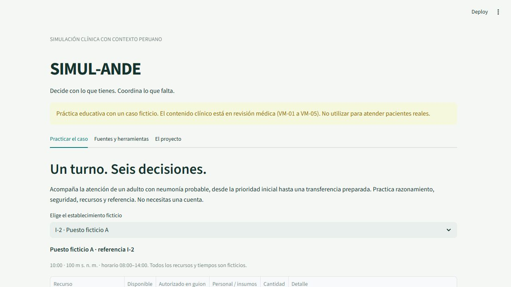
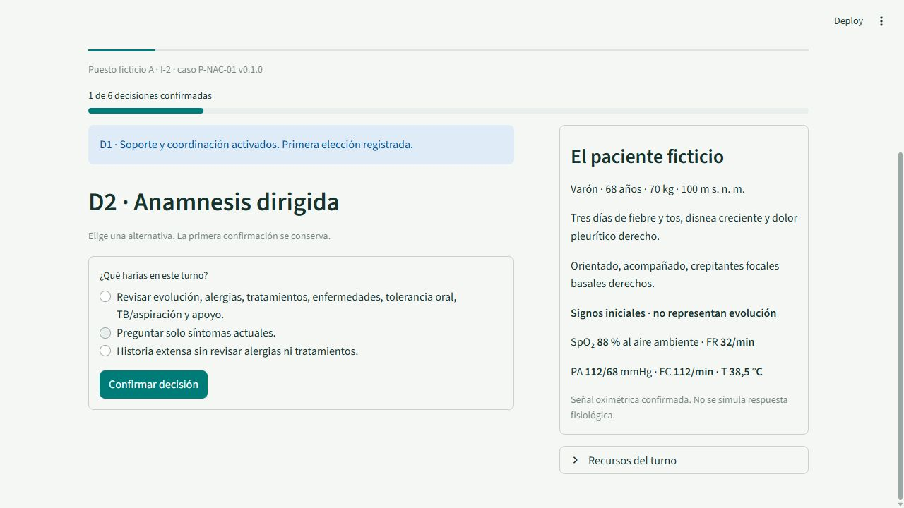
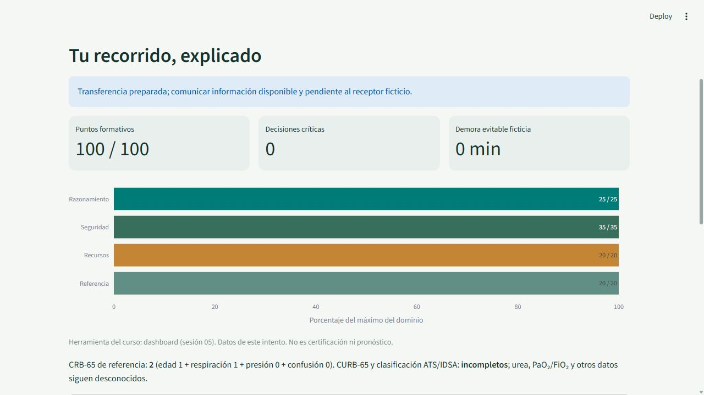
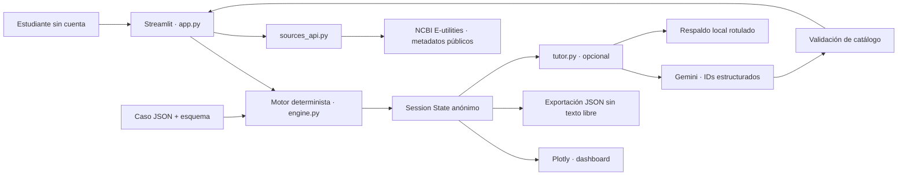

# SIMUL-ANDE

Prototipo educativo para el proyecto final [#204 · Q-Lab PUCP](https://github.com/d2cml-ai/Data-Science-Python/issues/204). Un caso sintético, dos establecimientos ficticios y seis decisiones. **Contenido clínico en revisión médica; no usar para atender pacientes reales.**

## 1. One-liner

Hacemos simulación clínica para estudiantes de medicina, internos y futuros médicos SERUMS mediante pacientes ficticios, recursos explícitos y retroalimentación trazable a fuentes peruanas.

## 2. Founder

Victor Roman, participante del diplomado Q-Lab PUCP, propone la brecha entre la práctica en simuladores y las decisiones con restricciones del primer nivel peruano. Su responsabilidad en el piloto es revisar el contenido con evidencia, conversar con usuarios y contrastar la plausibilidad de cada escenario. La biografía profesional detallada y las revisiones clínicas VM-01 a VM-05 siguen pendientes de confirmación documentada. No se declara una aprobación clínica por atribuir un nombre al proyecto.

## 3. Problema

Hipótesis: estudiantes e internos practican con recursos que pueden no tener en su internado o SERUMS. Eso puede dificultar priorizar soporte, decidir qué prueba puede esperar y coordinar referencia. No hemos medido frecuencia, costo económico ni disposición de pago. Alternativas a investigar: discusión con supervisores, guías, bancos de preguntas y simuladores existentes.

**Las tres conversaciones reales están pendientes.** [Guía y registro](docs/research/README.md); [plantillas vacías](docs/research/entrevista_01.md). No se inventaron usuarios, citas ni resultados de entrevistas. La consigna permite datos sintéticos: el paciente es ficticio y las métricas del tablero son resultados reales de ejecutar este software.

## 4. Solución e insight

Practicar desde la prioridad inicial hasta una transferencia preparada, con un inventario del turno que condiciona las acciones. I-2/I-4 son referencias de categoría; no garantizan stock ni autorización. Más exámenes no dan más puntos: dos rutas de D3 reciben la misma valoración.

El motor conserva la primera elección, intercepta propuestas inseguras y exige reconocer la corrección. Un error crítico permanece visible aunque el puntaje sea alto. El puntaje no certifica competencia y no predice desenlaces. No se generan cambios fisiológicos, resultados ausentes ni recomendaciones clínicas mediante IA.

## 5. Why now

Una interfaz web pequeña y contenido JSON permiten distribuir un caso sin instalar software en el teléfono del estudiante. Las reglas y pruebas automatizadas hacen auditables las transiciones. Las APIs públicas permiten consultar procedencia bibliográfica; las salidas estructuradas permiten acotar un tutor a un catálogo, cuando exista acceso real al modelo. El valor educativo y la demanda aún deben comprobarse con usuarios.

## 6. Demo

**[Abrir demo pública](https://simul-ande.streamlit.app/)** · [Repositorio público](https://github.com/victorroman1998/simul-ande) · [Video de respaldo, 68 s](docs/demo/simul-ande-demo.mp4).

Ejecución local: `http://localhost:8501`. Demo verificada en una sesión nueva y por HTTP sin cookies; ambos escenarios completan el recorrido. **29 pruebas aprobadas en Windows y [Linux CI](https://github.com/victorroman1998/simul-ande/actions/runs/42945324546)**. [Evidencias](docs/VALIDATION.md), [despliegue y entrega](docs/DELIVERY.md), [auditoría del ZIP](docs/AUDIT.md).

Python **3.12** recomendado. Desde esta carpeta:

```powershell
py -3.12 -m venv .venv
.\.venv\Scripts\python.exe -m pip install -r requirements.txt
.\.venv\Scripts\python.exe scripts/verify_package.py
.\.venv\Scripts\python.exe -m pytest -q
.\.venv\Scripts\python.exe -m streamlit run app.py
```

En macOS/Linux, sustituir el ejecutable por `.venv/bin/python`. En este equipo Windows también funciona el entorno ya instalado dentro de esta carpeta. No se necesita clave para completar el caso. No introducir datos personales.

Si se usa `uv` dentro de OneDrive, instalar con `uv pip install --link-mode copy -r requirements.txt` para evitar vínculos incompatibles con archivos de nube. El desarrollo se verificó con Streamlit 1.51.0 y Python 3.12; Community Cloud quedó configurado con Python 3.12.

Ruta de demostración: I-2 → iniciar → confirmar recursos → seis elecciones → tablero → reflexión → exportar JSON. Repetir con I-4 para observar RX disponible solo en D3-A y laboratorio pendiente. Todas las opciones se presentan sin selección inicial.

Capturas del software ejecutándose:





El video muestra un recorrido real I-2, las seis decisiones, el tablero, el tutor local y una respuesta real de PubMed. Se capturó a 2 imágenes por segundo y se codificó como MP4 de 68 segundos, 1280×720, sin audio. No contiene maquetas ni pacientes reales; puede descargarse como respaldo sin internet.



**APIs y modelos:** NCBI E-utilities consulta metadatos del PMID 31573350, bibliografía complementaria ATS/IDSA 2019. No cambia el caso. Gemini `gemini-2.5-flash-lite` es opcional: selecciona únicamente IDs de reflexión; el texto es local, no prescribe ni califica. Sin credenciales o ante error se muestra «Reflexión seleccionada por reglas locales; IA no disponible». No se llama RAG a este catálogo. El motor funciona sin internet; la API bibliográfica y el tutor requieren conectividad.

Para Gemini: copiar `.env.example` a `.env`, configurar en el servidor y confirmar un proyecto sin facturación o un límite efectivo del proveedor. `.env` está excluido de Git. Una llamada por intento, sin reintentos automáticos, timeout de 10 s y máximo de 150 tokens de salida; no es un tope global de gasto. No se presenta una prueba simulada como llamada real a Gemini. [Documentación oficial de salidas estructuradas](https://ai.google.dev/gemini-api/docs/structured-output).

Fuentes clínicas, adaptaciones y localizadores: [registro original](spec/SOURCES.md) y [reglas](spec/CLINICAL_RULES.md). La revisión médica permanece `pending`. Se enlazan los documentos oficiales, sin redistribuir PDFs completos. Licencia MIT del código en [LICENSE](LICENSE).

## 7. Modelo de negocio

Comprador por validar: coordinador docente. **Precio hipotético: S/300 por piloto de cuatro semanas para hasta 30 participantes**, con un caso y sesión de devolución (S/10 por participante a capacidad completa). Sin ventas, contratos ni pagos integrados.

En la demo base, cada usuario completa el flujo con **0 tokens de LLM**; PubMed no requiere una clave de pago. El servidor local no genera una factura de hosting; tiempo docente, revisión clínica, electricidad y soporte no están incluidos. Para Community Cloud se presupone su modalidad gratuita, sujeta a condiciones y límites; no se afirma tener una factura de producción de S/0.

Con IA habilitada: máximo de diseño 1 500 tokens de entrada y 150 de salida por intento. Costo en USD = `(tokens_entrada × tarifa_entrada + tokens_salida × tarifa_salida) / 1 000 000`. Para cuatro intentos por participante: hasta 6 000/600 tokens; para 30 participantes: 180 000/18 000. Registrar tarifas vigentes en las variables del servidor, según [precio oficial del proveedor](https://ai.google.dev/gemini-api/docs/pricing), antes de cotizar. La app muestra uso real y costo estimado solo si ambos se conocen; en otro caso, «costo no medido». No confundir presupuesto por usuario con gasto global protegido.

## 8. Herramientas del curso

| Sesión | Uso dentro del producto | Archivo y comprobación |
|---|---|---|
| 03 · APIs | Consulta real de metadatos públicos de PubMed en Fuentes y herramientas | [`sources_api.py`](sources_api.py), botón de consulta; `python scripts/verify_live_api.py` guarda evidencia de una respuesta online válida |
| 05 · Dashboards | Cuatro dominios normalizados, puntos, críticos y demora de este intento | [`app.py`](app.py), `show_result`; pruebas UI y todas las rutas del motor |
| 08 · Salidas estructuradas, opcional | Gemini elige un foco de reflexión entre IDs; validación de esquema y correspondencia | [`tutor.py`](tutor.py); pruebas de respuesta válida, IDs ajenos, fallo y bloqueo de gasto; llamada real pendiente de credenciales |

Las dos herramientas base son API y dashboard. La tercera no se acredita como IA ejecutada sin evidencia del proveedor. Este ajuste del paquete original está explicado en [AUDIT.md](docs/AUDIT.md). Codex usado para programar no se cuenta como herramienta del producto.

## 9. Qué hizo el agente

Codex inspeccionó el ZIP y la issue, creó el motor, la interfaz, las integraciones, las pruebas, la configuración, la documentación y los recursos de entrega. Conservó el caso original y la revisión clínica pendiente. No se usó Claude Code. No se inventaron entrevistas, validaciones, métricas de alumnos, historial de días anteriores ni llamadas reales a IA.

Victor debe revisar el código y las cinco decisiones médicas, realizar las conversaciones y verificar la presentación. No se atribuye al fundador una revisión que no se haya registrado. [Evidencias y limitaciones](docs/VALIDATION.md).
