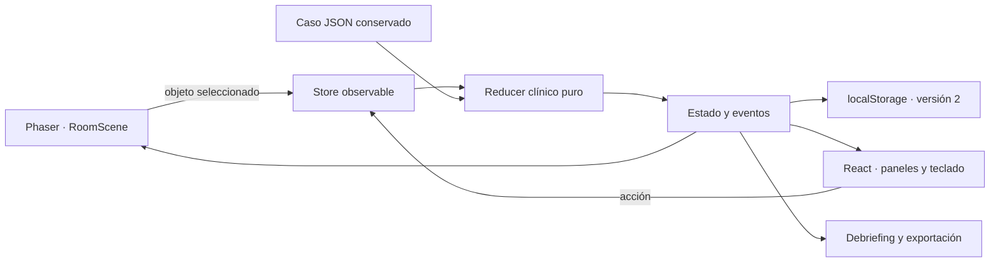

# SIMUL-ANDE · Guardia virtual 0.2

Prototipo vertical **ejecutable** con React, TypeScript y Phaser 3. Un paciente ficticio con NAC probable, dos inventarios y una sala 2D interactiva. Revisión clínica pendiente; no usar con pacientes reales.

La rama `prototype/visual-phaser` conserva el MVP Python/Streamlit en la raíz. El despliegue anterior continúa apuntando a main; este frontend se compila y publica de manera independiente. [Diagnóstico verificable](../docs/visual/DIAGNOSIS.md).

## Ejecutar

Node 24 y pnpm 11.25.0, probados en Windows y mediante CI. Desde `visual/`:

```sh
pnpm install --frozen-lockfile
pnpm test
pnpm build
pnpm dev --port 5173
```

Abrir la URL que imprime Vite. El build estático queda en `dist/`, apto para hosting HTTPS. No requiere Python, API keys, backend ni un LLM. El lockfile fija dependencias y `pnpm-workspace.yaml` autoriza solo el script de esbuild. No se usan fuentes o ilustraciones remotas en tiempo de ejecución.

## Cómo jugar

La habitación permanece a la vista. Haz clic en objetos dibujados por Phaser o usa la barra de objetos con teclado. Seleccionar no avanza el reloj. Para un instrumento: selecciónalo, prepáralo en el panel y haz clic en el paciente. Sus efectos se registran en el motor.

- Paciente: conversar sobre síntomas, seguridad farmacológica y contexto, en el orden que elijas. Cada tema ofrece respuestas fijas del caso.
- Oxímetro: colocar sensor y consultar el registro basal de 88 % al aire ambiente.
- Estetoscopio: exploración inicial agrupada; FR, PA, FC, temperatura y auscultación del guion.
- Oxígeno: instalar soporte disponible. Aparece la conexión en la escena; no se calcula una mejoría.
- Botiquín: preparar TX01. El motor revisa entrevista completa, autorización, personal, insumos y stock; descuenta dos viales y una tableta una sola vez.
- Teléfono: confirmar receptor/transporte en paralelo y registrar o actualizar la entrega clínica.
- Salida: preparar traslado asistido. Una propuesta de salida insegura queda interceptada y registrada.
- Reloj: avanzar cinco minutos docentes voluntariamente. No hace falta esperar pruebas o ambulancia para preparar la transferencia.

I-4 muestra físicamente RX y laboratorio, más stock y una fuente de oxígeno de mayor autonomía declarada. I-2 carece de esos servicios. La RX de I-4 se solicita en paralelo y ofrece solo el informe sintético autorizado después de 20 minutos docentes; laboratorio sigue sin valores disponibles. Los dos recorridos pueden finalizar sin RX.

La evaluación aparece al finalizar, sobre acciones realizadas, oportunidad, seguridad, recursos y referencia. No hay seis preguntas ni opciones A/B/C. El reporte conserva críticos, muestra la bitácora y permite descargar JSON sin información personal. Volver a ver la sala no reabre el intento terminado.

## Arquitectura



`src/game/RoomScene.ts` dibuja arte vectorial original, hotspots y animación ambiental. No decide resultados clínicos. `src/clinical/engine.ts` define transiciones, prerrequisitos, tiempo y evaluación. `store.ts` enlaza las vistas y guarda en `simul-ande:visual:v2`. React usa `useSyncExternalStore`; no existe un motor duplicado en el canvas. `src/data/case.json` es una copia exacta del caso previo; el original y sus fuentes no se sobrescriben.

Recargar recupera el intento en este navegador. No hay sincronización entre equipos ni autenticación propia del estudiante. Una versión incompatible o datos corruptos se rechazan sin romper la sesión; si el navegador niega almacenamiento, se informa y se puede continuar. El resultado puede exportarse. Los datos guardados son ficticios; no introducir información de pacientes.

## Límites clínicos y educativos

Las reglas son propuestas docentes en revisión VM-01–VM-05. La animación de pecho y parpadeo es ambiental y no representa FR, hipoxemia, gravedad ni respuesta al soporte. Puede desactivarse. Los signos son el registro inicial. Si se coloca el oxímetro después de instalar oxígeno, el motor no inventa una lectura actual: informa valor posterior desconocido y distingue el registro basal del guion.

TX01, dosis y momento pretransferencia se conservan como adaptación pendiente de VM-03; no se enseñan reconstitución, técnicas de administración ni alternativas. El cierre como «transferencia preparada» requiere evaluación, entrevista, soporte, coordinación y entrega actualizada. TX01 no es un bloqueo universal de traslado; su omisión se comenta en el debriefing y la ponderación propuesta refleja esta limitación.

Los minutos y el corte de coordinación temprana de cinco minutos son reglas docentes propuestas, no umbrales terapéuticos. No se simulan muerte, deterioro, respuesta antibiótica, mortalidad, recuperación, fisiología a la altura ni cambios de dotación de personal con el tiempo. No se deduce severidad ATS/IDSA del CRB-65 ni se convierten ausentes en normales. Los puntos no certifican competencia y un crítico permanece aunque el total sea alto.

Fuera del alcance: movimiento de un avatar médico, física corporal, imágenes DICOM, voz, entrevista libre, otras enfermedades, cuentas institucionales y eficacia educativa validada. El arte del paciente es una representación 2D; no es una fotografía ni una maqueta que sustituya el juego.

## Evidencia

[Pruebas y recorridos reales de navegador](../docs/visual/VALIDATION.md), [diagnóstico previo](../docs/visual/DIAGNOSIS.md), [caso y reglas originales](../spec/CLINICAL_RULES.md). Las capturas documentan software en ejecución; la implementación no reproduce un video.
